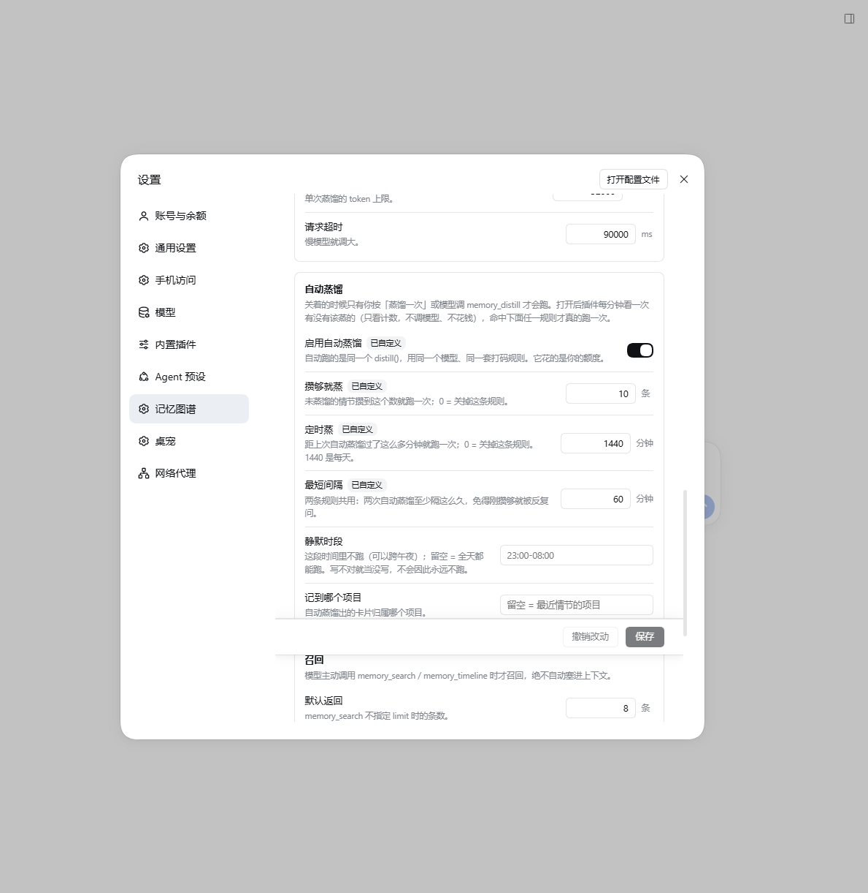
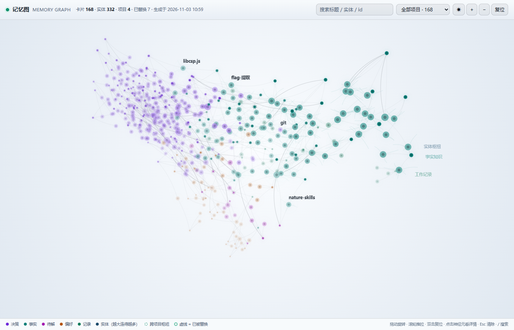
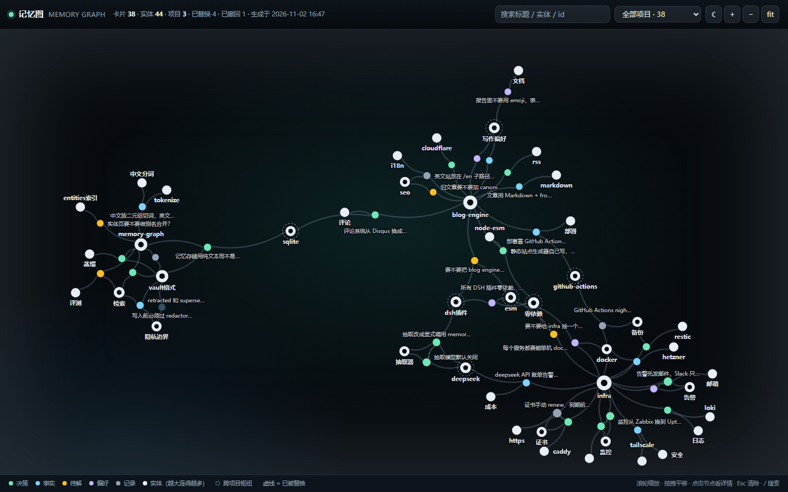
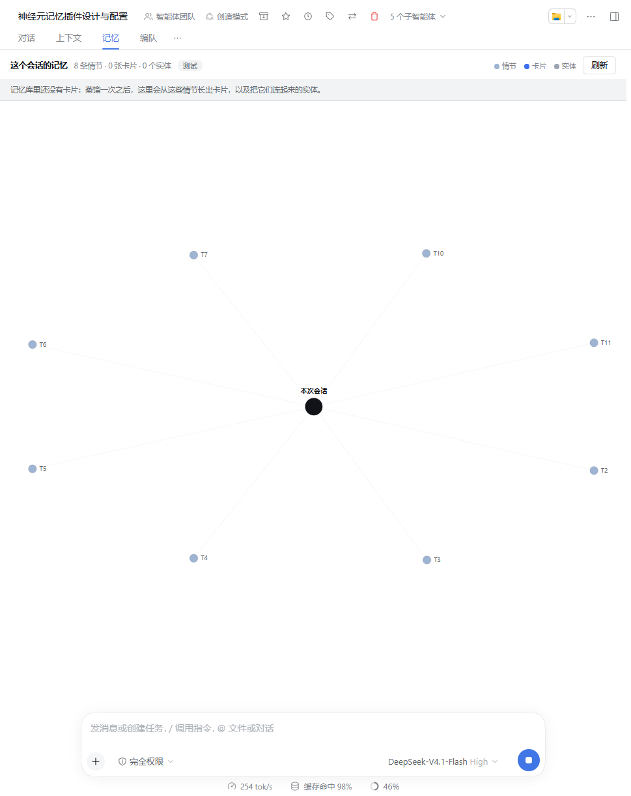
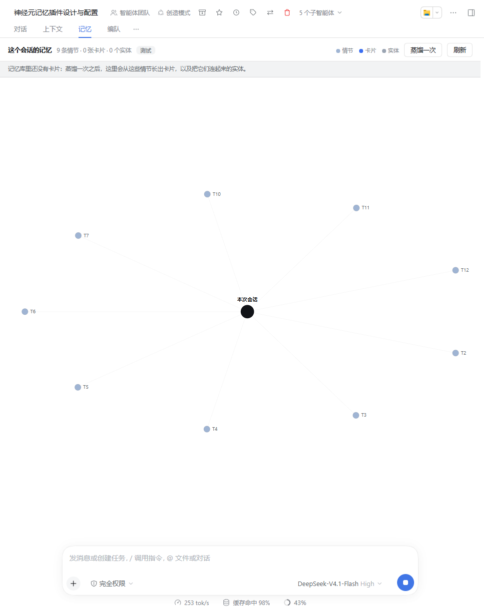
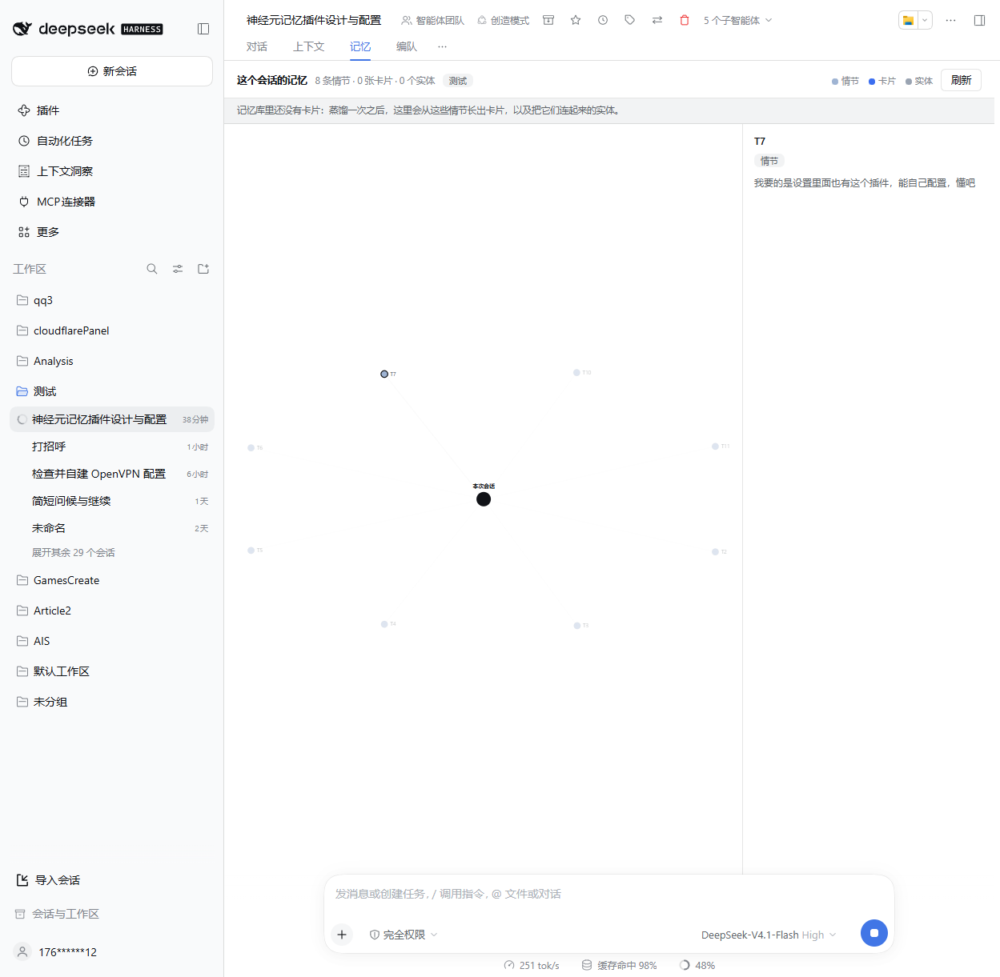
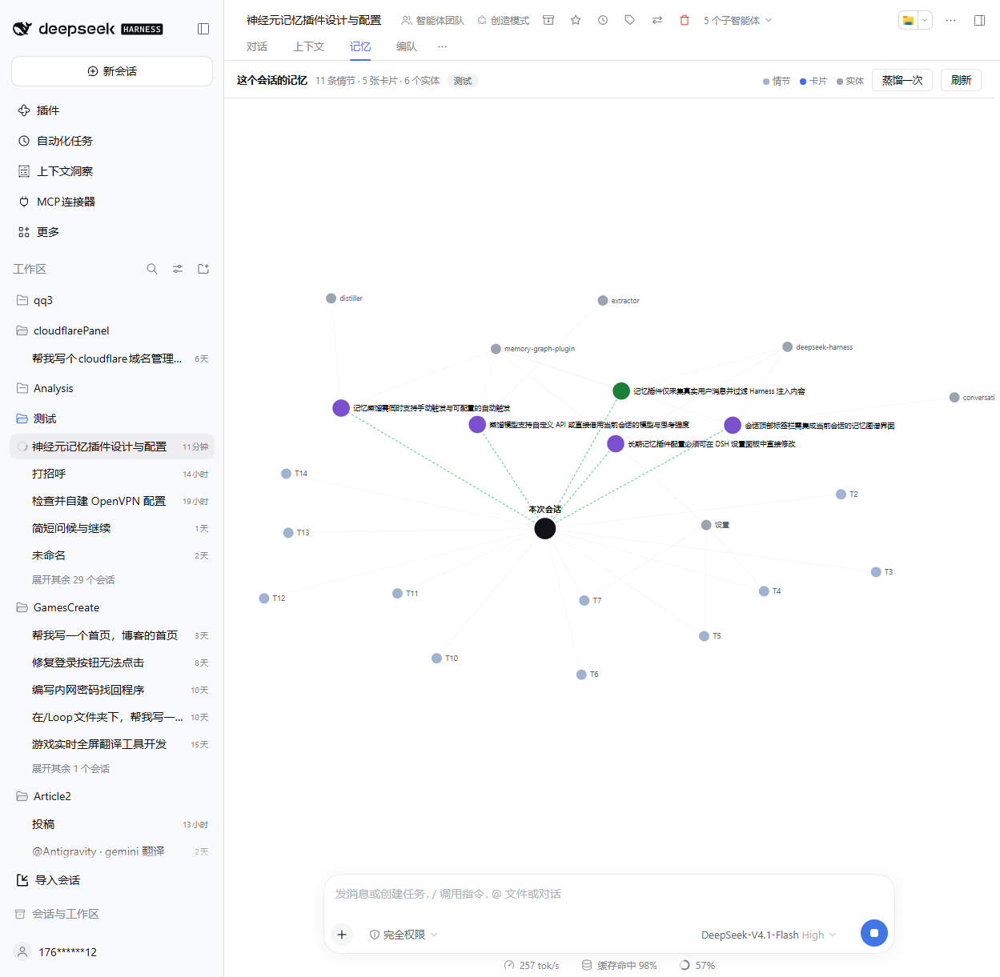

# dsh-memory-graph

English · [中文](README.md)

[](https://github.com/ilaomianyang/dsh-memory-graph/actions/workflows/test.yml)

Long-term **associative memory** for [DeepSeek Harness](https://getartcraft.com) (DSH).

Context compaction quietly deletes things. This plugin keeps a second layer — outside the context window, on your own disk, readable by you — so that a decision you made three months ago can still be found.

Plain Node ESM, no build step. Its configuration lives in **Settings → Memory Graph** (four groups on one page, applied on save); there are two places to look — the **Memory tab in a conversation** draws what that session remembered, graph.html at the vault root draws the whole library.

The only third-party dependency is the harness's own `@deepseek-ai/schemastery`, which supplies the config schema (the page reads the value projected from it); without it the plugin still runs and the Memory Graph page simply does not appear.

---

## How this differs from "compressing the context"

| | Context compaction | This plugin |
| --- | --- | --- |
| Goal | make the current conversation fit | make last quarter's decision findable |
| Loss | compressed away = gone | raw events are append-only, never rewritten |
| Structure | one paragraph of summary | typed cards with time, provenance and entity links |
| Change | invisible | conflicts become a supersede chain you can read |
| Location | inside the session log | a folder of plain files you own |

Compaction is a **working-memory** strategy. This is **long-term memory**. They coexist; neither replaces the other.

## Three layers

```
episodes/   raw      one JSON line per turn, never distilled, never deleted
cards/      semantic typed memory cards distilled from the raw layer (markdown)
entities/   index    one page per thing, with a timeline of mentions
```

Retrieval reads `cards + entities`. `episodes` is the raw material for distillation, and the audit trail when something looks wrong.

### A card

```markdown
---
id: "c-20261102-7f3a"
kind: "decision"
title: "Store memories as plain text instead of SQLite"
project: "memory-graph"
entities: ["vault-format", "sqlite"]
created: "2026-11-02T15:40:12+08:00"
valid_from: "2026-11-02"
valid_to: null
status: "active"
confidence: "user_stated"
source: {"kind":"agent","project":"memory-graph"}
supersedes: []
tags: []
---
SQLite would need locking and binary merges. Plain text can be read, grepped and
backed up directly.
```

`status` is only ever `active`, `superseded` or `retracted`. **A belief that was overturned is never deleted** — it becomes `superseded` and points at the card that replaced it. That is what makes "how did this come to be" readable.

## Install

```
git clone https://github.com/ilaomianyang/dsh-memory-graph
cd dsh-memory-graph
npm install                 # one dependency: the harness's own schema library
```

Then, in Harness, let the model run this, or point the plugin manager at that directory:

```
plugin_manager action=install_bundle target="<absolute path of the clone>"
```

`install_bundle` links a local directory with `link:`, which does **not** install the package's dependencies, so do not skip `npm install` above. Without it the plugin still runs — there is simply no Memory Graph page in Settings.

To follow along: `git pull`, then reload the plugin (`plugin_manager action=set_plugin target="include:memory-graph" enabled=false`, then `enabled=true`).

The vault defaults to `~/dsh-memory` and is created on activation.

**Restart Harness once after installing** (close the window and reopen it). Not out of laziness: the web-side plugin manifest is composed by scanning the running loader's entries at startup and reading each package's `dsh.client` field, and that scan is cached in the process — it is never repeated. So a fresh install, or any edit to `client.js` or `package.json`, needs a new process; install without restarting and the sidebar simply has no Memory Graph entry, with no error anywhere to tell you why.

After the restart it is **Settings → Memory Graph**, between Models and Plugins.

Uninstall with `plugin_manager action=remove_bundle target="dsh-memory-graph"`. The vault is not touched — it lives in `~/dsh-memory`, independent of the plugin.

## What you get on disk

```
~/dsh-memory/
├── vault.json                   schema version, creation time
├── projects.json                project slugs seen so far
├── README.md                    generated index linking every card
├── graph.html                   generated memory graph, open it in a browser
├── episodes/2026-11-02.jsonl    raw layer: one line per turn, append-only
├── cards/2026-11/               semantic layer: one file per card
│   └── c-20261102-7f3a.md
├── entities/                    index layer: one page per thing
│   └── vault-format.md
└── audit/2026-11.log            redaction audit (which rule fired, never the text)
```

One file is one memory. Append-only. No binaries, no lockfiles. Run `git init` inside it if you want version history, or `grep -r` the whole vault.

**This is your private local data.** What gets shared on GitHub is the plugin, not the vault.

## Configuration

**Settings → Memory Graph.** The plugin contributes its own page to the Settings sidebar, four groups: capture / privacy / extractor / retrieval. Every field carries a bilingual description and applies the moment you press Save — no restart, no reload.

- A field you changed is badged as changed; the restore link next to it goes back to the default rather than blanking the value.
- A rejected save says why (a number out of range, a host that was changed elsewhere in the meantime) instead of swallowing the edit.
- The extractor group follows the route you pick: `harness` shows only the model knobs, `http` reveals the endpoint and key.

**Four keys are not on that page**: the master switch `enabled`, the vault directory `vaultDir`, the default project tag `defaultProject`, and `crossProject`. The plugin consumes them once while activating (where the vault lives, which project to file under, whether to link cross-project entities), so changing one reloads the plugin, and they stay hand-written in your profile's `cordis.patch.yml`. The same row's `config` accepts the page's keys too — **the YAML is the final word**, and either place works:

```yaml
- id: memory-graph
  config:
    vaultDir: '~/dsh-memory'
    capture:
      enabled: true
      userChars: 1500
      assistantChars: 1500
    privacy:
      redactEmails: true
      redactPaths: true
      denyPatterns: ['my-internal-domain\\.corp']
    extractor:
      enabled: true
      transport: 'harness'      # default: reuse the model selected in Settings, no key of its own
      maxEpisodesPerRun: 40
    retrieval:
      limit: 8
      hops: 1
```

| Key | Default | Meaning | On the page |
| --- | --- | --- | --- |
| `enabled` | `true` | master switch; off means the plugin is not loaded at all | — |
| `vaultDir` | `~/dsh-memory` | where the vault lives, `~` supported | — |
| `defaultProject` | `shared` | project tag for sessions with no usable cwd | — |
| `crossProject` | `true` | link new cards into project-level entity hubs | — |
| `capture.enabled` | `true` | append raw events automatically | ✓ |
| `capture.userChars` | `1500` | how much of each of your messages is kept, truncated beyond | ✓ |
| `capture.assistantChars` | `1500` | how much of each assistant reply is kept | ✓ |
| `capture.includeToolOutput` | `false` | record tool names and call counts (**never their contents**) | ✓ |
| `capture.minChars` | `12` | turns shorter than this are not stored ("ok", "continue") | ✓ |
| `capture.skipPatterns` | 3 built-in | fallback regexes for old logs that carry no provenance | ✓ |
| `privacy.useDefaultPatterns` | `true` | built-in key / private-key / token rules | ✓ |
| `privacy.denyPatterns` | `[]` | your own regexes, `(?i)` prefix supported | ✓ |
| `privacy.redactEmails` | `true` | addresses become `[email]` | ✓ |
| `privacy.redactPaths` | `true` | the home directory becomes `~` | ✓ |
| `extractor.enabled` | `false` | when off, capture still happens but no model is ever called | ✓ |
| `extractor.transport` | `harness` | `harness` = borrow the model from Settings; `http` = fill in your own endpoint | ✓ |
| `extractor.useCurrentModel` | `true` | harness mode: follow the model currently selected | ✓ |
| `extractor.provider` | `''` | harness mode: provider id, used when "follow" is off | ✓ |
| `extractor.reasoningEffort` | `''` | harness mode: thinking level, empty = whatever Settings has | ✓ |
| `extractor.maxEpisodesPerRun` | `40` | how many episodes one distillation may feed in | ✓ |
| `extractor.maxOutputTokens` | `3000` | output token cap per run | ✓ |
| `extractor.timeoutMs` | `90000` | timeout of a single call | ✓ |
| `extractor.baseUrl` | `https://api.deepseek.com/v1` | http mode: any OpenAI-compatible endpoint | ✓ (http) |
| `extractor.path` | `/chat/completions` | http mode: the path | ✓ (http) |
| `extractor.model` | `''` | model id; empty means `deepseek-chat` in http mode | ✓ (http) |
| `extractor.apiKeyEnv` | `MEMORY_LLM_API_KEY` | http mode: the key is looked up under this name | ✓ (http) |
| `extractor.apiKey` | `''` | http mode: the key inline (not recommended, see below) | ✓ (http) |
| `extractor.temperature` | `0.1` | http mode only: in harness mode sampling belongs to the borrowed route | ✓ (http) |
| `auto.enabled` | `false` | switch automatic distillation on; off leaves only the button and the tool | ✓ |
| `auto.minEpisodes` | `0` | run once this many undistilled episodes are waiting; 0 turns the rule off | ✓ |
| `auto.everyMinutes` | `0` | run once this many minutes have passed; 0 turns the rule off | ✓ |
| `auto.minGapMinutes` | `30` | shared by both rules: minimum gap between two automatic runs | ✓ |
| `auto.quietHours` | `''` | window in which nothing runs (e.g. `23:00-08:00`, may cross midnight) | ✓ |
| `auto.project` | `''` | project automatic cards are filed under | ✓ |
| `retrieval.limit` | `8` | how many cards one search returns | ✓ |
| `retrieval.hops` | `1` | entity expansion depth, `0` = keyword only | ✓ |
| `retrieval.snippetChars` | `320` | how much of each hit the model gets to read | ✓ |
| `retrieval.timelineLimit` | `20` | how far back `memory_timeline` looks by default | ✓ |

Why only those 34 are editable there: the harness projects **only fields declared `volatile`** — the ones read each time they are used. Everything marked ✓ is read at call time, so one save changes the next call. `enabled` / `vaultDir` / `defaultProject` / `crossProject` are consumed during activation and would need a remount, so they are left out rather than shown as knobs that do nothing; the page's footer says exactly that.

### When it distils on its own: two rules

By default it does **not**. With `auto.enabled` on, the plugin looks once a minute at whether a run is due — and that look is arithmetic only (how many episodes are waiting, how long since the last attempt, is this a quiet hour). **No model call, no cost.** Only a rule that matches starts a run, and it runs the same `distill()`.

The two rules are independent: either one alone, or both.

| Rule | Setting | Fires when |
| --- | --- | --- |
| Distil once enough pile up | `auto.minEpisodes` | undistilled episodes ≥ this number (say 10) |
| Distil on a schedule | `auto.everyMinutes` | this many minutes have passed since the last automatic run (1440 = daily) |

Three gates both rules share:

- `auto.minGapMinutes` (default 30): never two automatic runs closer than this. It is checked before the rules — a vault that just crossed the threshold should not be asked again a minute later, and every ask costs money.
- `auto.quietHours` (default empty): nothing runs inside this window; it may cross midnight (`23:00-08:00`). Unreadable text is ignored rather than silencing the feature forever.
- `auto.project` (default empty): which project automatic cards are filed under; empty uses the newest episode's project.

A few deliberate choices:

- **The schedule clock starts when you switch it on**: it does not run on the spot — a daily schedule should not spend the moment you flip the switch. That clock is stored separately (`startedAt`) and is not treated as "the last run", so it does not push the threshold rule back by one minimum gap either.
- **The gap is armed before the call**, so a run that produced nothing still counts and will not be re-asked the next minute. It is recorded in `.auto-state.json` in the vault (`lastAttemptAt` only), so **a restart does not reset it**.
- That file is not `.distill-state.json`: the latter is the **cursor** (which lines have been read), the former is the **attempt clock**. Merging them would make "read, but produced nothing" impossible to express.
- Automatic runs, the button and `memory_distill` share **one lock**: while a run is in flight, the other callers are told so rather than queued, so two of them can never spend at once.
- To stop it: `auto.enabled = false` (master switch), or set both rules to 0 (the switch stays on, no rule matches, nothing runs).



That is the real thing: master switch on, run once 10 episodes are waiting, top up daily, never closer than 60 minutes apart, quiet hours empty. Save it and the very next tick decides on the new values — no remount, no restart.

### One distillation runs in batches

`maxEpisodesPerRun` is how many episodes **one distillation** may read, not how many go into one model call. The plugin derives the batch size from `maxOutputTokens` (roughly 320 output tokens per episode), one call per batch, each batch committed before the next: forty episodes become five small calls instead of one request asked to produce forty cards.

Two reasons. The answer has to fit the output budget; and when one batch fails (rate limit, timeout, dropped connection) the cards from the earlier ones are already written and the distillation cursor already moved, so a re-run only picks up the rest. If a batch is still truncated anyway, the plugin halves it and retries — a single episode that overflows is the only real failure, and it is reported as such (the `maxOutputTokens` message).

`memory_distill` with `dryRun` previews the first batch only and says how many episodes are left: a preview should not spend your budget on the whole backlog.


### Two ways to hook up the extractor

**A. Borrow the model from Settings (the default)**

With `transport: 'harness'` the plugin touches no key and no endpoint: it asks the harness `llm` service for one call and gets exactly what you selected in **Settings → Models** — provider, model, and thinking level. The key is already configured there, so the plugin never needs a second one.

- Want a different extraction model? Change it in Settings; the next distillation follows.
- Want to pin a cheap small model to extraction? Turn `useCurrentModel` off and fill in `provider` + `model` (e.g. `deepseek` / `deepseek-chat`); the key still comes from Settings.
- Want a cheaper or stronger thinking level? Set `reasoningEffort` to one of the ids that model offers in Settings (e.g. `high`); leave it empty to reuse your selection.
- No secret can leak on this route: the plugin reports only the provider / model / effort it used, never a credential value.

**B. Your own endpoint (`http`)**

The extractor is fully independent: its own endpoint, model, and budget. Use it when extraction should run on a model configured elsewhere, behind your own gateway, or when this harness build exposes no `llm` service.

The settings page also has an `extractor.apiKey` field (a password input that never echoes what you saved), but **do not use it**: whatever you type there is written in plaintext into the profile config. Pointing `apiKeyEnv` at a name and keeping the value in the environment or `~/.dsh/.credentials.yaml` is the intended route.

### Where the key comes from (http mode)

Tried in this order; whichever answers is used, and the value is never logged, never audited, never written into the vault:

1. `extractor.apiKey` in the config (not recommended — it ends up in YAML)
2. the process environment variable named by `extractor.apiKeyEnv`
3. **the harness's own credential store**: `refs.<apiKeyEnv>` in `~/.dsh/.credentials.yaml`

Point 3 means that if the key is already configured for the harness (`DEEPSEEK_API_KEY`, say), you just set `apiKeyEnv` to the same name instead of exporting anything. Reading the store parses the `refs:` block only and touches nothing else. `memory_stats` prints an `extractor:` line naming the route and model it would use — never the value.

## Tools

| Tool | What it does |
| --- | --- |
| `memory_search` | cross-project retrieval: id, snippet, and why it matched |
| `memory_get` | one card in full, plus its entities |
| `memory_timeline` | chronological view that keeps the supersede chain visible |
| `memory_graph` | walk from an entity or a card to connected memories and neighbouring entities |
| `memory_remember` | write a card explicitly |
| `memory_forget` | `retract` (keeps the trace) or `purge` (deletes the file) |
| `memory_distill` | turn raw episodes into cards with the extractor model |
| `memory_stats` | vault location, counts, last distillation |

`memory_graph` is the "neuron" part made concrete: an edge is not invented, it is **two cards mentioning the same entity**. It claims co-mention, never causation — the model decides what that means.

**Nothing is injected automatically.** Memory only enters the context when the model asks for it. Most turns do not need long-term memory, and injecting it would be pure cost.

## Look at your memory

`memory_stats` tells you where the vault is; in its root there is also **`graph.html`** — double-click it, nothing to install, no server:



- **Entities are the large dark hubs** (`infra`, `deepseek`, `blog-engine`, `memory-graph`…), sized by how often they are mentioned — the cross-project ones stand out immediately.
- **Cards are the small coloured dots**, coloured by kind: decision / fact / open question / preference / note.
- **Dashed edges are replaced memories** (`superseded`), so you can see where the record changed its mind; retracted cards stay visible, greyed out.
- Search by title / entity / id, filter by project, click a card for its detail, hover to highlight one-hop neighbours, scroll to zoom, drag the background to pan, `Esc` to clear.
- Follows the system light/dark setting; you can also open `#dark`, `#light`, or `#dark&<card id|entity slug>` to pin the theme and jump to one card.
- Redrawn after every `memory_remember` / `memory_forget` / `memory_distill`. An empty vault and a one-card vault both render something readable instead of a blank page.

It is **one self-contained HTML file**: no CDN, no framework, no build step, no network requests — the data is inlined at render time. 38 cards → 101 KB. Delete it if you like; the next write regenerates it.

Dark:



One honest limit: `graph.html` is a **static snapshot of the whole vault** — double-click it, no harness needed. "What did *this* conversation remember?" is a different picture, and it lives in the GUI: see the next section.

## The Memory tab in the GUI

The Conversation tab row (对话 / 上下文 / 编队 / …) gained a cell: 记忆 (Memory). It draws **only this session**:

- The dark node in the middle is the session. The pale blue nodes around it are the episodes it wrote (`T1`, `T2`, …).
- **Green dashed edges** are the cards this session's own words would actually retrieve — computed with the same `searchCards` the model calls, so what is lit here is what the model really gets when it asks "do you remember?".
- Grey nodes are entities: a card and an entity are joined when the card mentions it, an episode and an entity when that turn named it.
- A card from another project arrives through a shared entity (dashed outline, one shade dimmer). That is the only reason the entity layer exists, so it is visible on the graph.
- Click any node and the side panel opens its full text; click the empty canvas to close it. The header carries the counts, the project, the cross-project count and a refresh button, and the tab re-reads quietly every 20 seconds while it is open.



Two buttons sit in the header: **Distill now** and **Refresh**.



Click an episode and the side panel shows what you actually said that turn:



The first screenshot is a vault that has not been distilled yet — episodes but no cards or entities, which is exactly what the note at the top of the panel says. After one **Distill now**, the same session looks like this: purple cards, grey entities, the session itself in the middle, and dashed edges for "this was said here".



The cards in that picture are what this very conversation distilled into — including the requirements it was asked for.

The data is not baked into the page: the host registers two exact Fetch routes — `/api/memory-graph.graph` (GET, this session's graph) and `/api/memory-graph.distill` (POST, run one distillation when someone presses the button). DSH's Connection verifies the browser's signature first and only lets an owner Peer through, so the plugin needs no second auth scheme and never exposes the vault directory to the page. The layout is computed on the **host** (deterministic force layout) and the browser only draws the coordinates, so reopening the tab shows the same picture.

Caps: 40 episodes, 60 cards, 40 entities, 12 cross-project cards, 420 edges. The header still reports the real totals — a graph that cannot be read is not worth drawing.

> How a change takes effect: editing `client.js` needs only a page refresh (the host reads that file per request); editing the host side (`index.js` / `src/*.js`) needs the plugin to re-`apply`, which the plugin manager does when you switch 记忆图谱 off and on again — no full restart.

## Cross-project means one person's projects, not shared memory

You set "every script must be zero-dependency" in project A. Three months later, in project B, you ask whether a build step can be dropped — `memory_search` surfaces the card from A, because both mention the entity `zero-dependency`.

That is the only reason the entity layer exists.

## Privacy

Enforced **before** the write, not cleaned up afterwards:

- built-in rules: API keys, private-key blocks, `password=` forms, Bearer tokens
- `redactEmails`: addresses become `[email]`
- `redactPaths`: your home directory becomes `~`
- `denyPatterns`: your own regexes

Matches become `[REDACTED]`. The audit log records **which rule fired, never the matched text**. If something slips in anyway, `memory_forget mode=purge` deletes the file.

### Only what you actually said

The harness delivers runtime snapshots, skill catalogs, sampled timestamps, approval notices and compaction checkpoints **disguised as user messages**. Those are not your words, and distilling them would manufacture memories out of nothing.

So capture checks **both**, and both must pass: `source.kind` (anything but `user` is dropped) and the `capture.skipPatterns` text rules.

Why both, rather than provenance alone: provenance is not always right — a 1501-character image-tool briefing once sat in a real vault tagged `kind: 'user'`, and was stored as if the person had typed it. Provenance may only *add* a skip; it cannot veto the patterns.

Delimited injections (`<system-reminder>…</system-reminder>`) are stripped before that decision, so a real message that carried one keeps what the person typed instead of being dropped whole.

Side benefit: an injected message no longer cuts a turn in half, so an episode's boundary is the real turn boundary.

#### Two known limits

- **No backfill.** Capture starts the moment the plugin is present (the first episode in this vault is 2026-11-02 15:53, when it was first loaded). Older sessions have no episodes, and the plugin does not read historical session logs — memory grows from the moment you install it.
- **Subagent sessions are captured too.** A subagent's opening prompt is stored as one episode (its project inferred from the cwd). Those are internal instructions, not your memories; there is no filter for them yet, so it shows up as one line of noise.

## Design decisions worth knowing

1. **The entity layer is what makes cross-project work.** Two projects sharing "the same Postgres instance" or "the same tool" connect through an entity page, instead of hoping a vector similarity finds it.
2. **Temporal validity `[valid_from, valid_to]`.** Without it the graph lays this quarter's plan next to last quarter's and lies to you quietly.
3. **The write unit is an episode, not a fact.** `episodes` records when, why and who decided; `cards` are conclusions derived from episodes.
4. **Forgetting is a feature.** `retract` keeps the trace, which is more honest than pretending it never happened; `purge` is the real delete.
5. **The graph is a derived cache.** The session log is the source of truth; every card can be re-distilled from episodes.

## Testing

No network, no real vault:

```bash
npm test        # 43 + 13 + 32 + 12 + 22 + 54 + 15 + 11 + 19 = 221 checks, plus the 25-question retrieval eval
npm run eval    # retrieval eval only (offline, deterministic)
```

- `test/smoke.mjs` — storage, redaction, BM25 retrieval, entity expansion, supersede chain, extractor parsing; and near-duplicate titles not forking the graph (a re-worded card folds into the old one, the fuller body wins, never across projects, and a card that names its `supersedes` is a reversal rather than a duplicate)
- `test/schema.mjs` — the Settings page must not drift from the runtime: every leaf of `Config({})` is compared with `resolveConfig({})` in both directions (`vaultDir` is the one exception — the page holds raw text, the runtime an absolute path), so a dead control and an invisible setting both fail; plus the transport union, numeric bounds, the `secret` role on the inline key, the volatile leaves matching the page's field table exactly, and the four structural keys staying off it
- `test/client.mjs` — mounts the page on a minimal React stand-in: the controls drawn equal the fields that should show, switching `transport` reveals the http knobs, an empty inline key is never sent as a deletion, an out-of-range number never reaches the wire, a refused save clears the drafts and explains itself, restore sends `unset` rather than `set`, a value that merely repeats the inherited default is not badged as a customisation, the stylesheet is a single `<style>` tagged with the package name, and `client.js` contains no `export`/`import` (the loader evaluates it as a script). It then evaluates `client.js` in a fake page carrying `window.__ModuleLoader__` and walks the real browser path — factory, `apply`, both slot registrations — checking that `react` is the only module required, the registration id is the package name, the orders are 25 and 30, and the labels follow the page language. Finally it drives the **Memory tab**: one request per paint carrying this `sessionId`, every node and edge the host sent drawn, a click opening the card's title and body in the side panel, and both the empty session and the failing route explaining themselves instead of going blank
- `test/graphdata.mjs` — the Memory tab's data: episodes filtered by `session`, majority project, the recall query taking the newest turns, a deterministic layout inside the box, every edge pointing at a node that exists, a cross-project card arriving through a shared entity, the caps reporting that they held, no assistant text in the payload, and the route answering 400 / 200 / 500 for missing session, normal, and a broken vault
- `test/capture.mjs` — drives the capture listener with real `session/event` shapes, including injected context
- `test/tools.mjs` — runs `execute` + `render` for all eight tools
- `test/distillapi.mjs` — the Distill now door: `/api/memory-graph.distill` on the authenticated `/api` channel, running the same `distill()` (live vault, the model selected in Settings, the live redaction rules), one press is one run, a concurrent second press is refused instead of queued, an extractor refusal is a 200 and not a 500, a throw is a 500 with the lock still released, views are re-rendered only when cards were written, a render failure only warns, the card list is capped at 40, and a route with no runner answers 500 instead of throwing at the browser
- `test/auto.mjs` — the automatic distiller: each rule fires on its own, whichever matches first runs when both are on, the minimum gap is checked before the rules, a quiet window may cross midnight, a tick only decides (an off switch does not even read the vault), one tick is at most one run, the gap is armed before the call, a restart reads `.auto-state.json` instead of starting over, a run that wrote nothing still arms the gap, an in-flight run is not stacked on, failures are logged with their reason, the project reaches the run, an unreadable vault is a skip and not a crash, and the tick asks for enough episodes to see the threshold
- `test/extract.mjs` — the extractor: `fetch` stubbed for the http route (prompt construction, key resolution order, tolerant JSON parsing, per-card project attribution, cursor advance, dry run writing nothing, secrets stopped before the write), then a fake `llm` service for the harness route (borrows the Settings model and thinking level, honours an explicit override, explains a missing selection, handles every terminal `finish`, reports cancellation, rejects an empty completion, and never touches `fetch`), and finally batching: the batch size derived from the output budget, a long backlog split across calls, a truncated batch halved and retried, earlier batches kept when a later one fails, and `dryRun` previewing only the first batch

Two suites do touch the network (and cost money), so they are not in `npm test`:

```bash
npm run live             # real model, end to end: 3 episodes → distill → search them back
npm run live:supersede   # real model: record a decision, then correct it, check the supersede chain
node test/live.mjs --backlog 12 --tokens 3000   # 12 episodes, watch it really split into two batches
node test/live.mjs --tokens 900                 # a small output cap, watch a truncation split in half
```

They read the key from `~/.dsh/.credentials.yaml` or the environment (see above); nothing is hard-coded or persisted. Both run in a plain `node` process with no harness `llm` service to borrow, so they set `transport: 'http'` explicitly — the plugin's own default is `harness`.

## Distillation, measured (real runs, not estimates)

With `deepseek-chat` via `npm run live`:

| Input | Output | Time | Tokens |
| --- | --- | --- | --- |
| 3 synthetic episodes (mixed zh/en, 2 projects) | 5 cards, project attribution 5/5 correct | 2.9 s / 3.6 s (two runs) | ≈1,590 |
| a real 266-event session log → 2 captured episodes (1,501 + 278 chars) | 9 cards (8 decision + 1 preference), Chinese in, Chinese out | 5.9 s | 2,816 (prompt 1,795 / completion 1,021) |
| 12 episodes (one conversation repeated four times, to force duplicates) | 2 batches (9 + 3) → 4 cards, the second batch entirely re-confirmations | 5.9 s | 4,153 (prompt 3,114 / completion 1,039) |

The first version fed every pending episode into a single call. Its first run against a real vault hit the wall: 23 episodes wanted thirty-odd cards, 3,000 output tokens cut the answer off, and the whole run was wasted. Now it batches by the output budget — **the same backlog, as several small calls, is both faster and harder to break**.

`npm run live:supersede` checks that temporal validity actually moves: round one records "share it on GitHub", round two the user corrects "the *plugin* is shared, not the memories"; the extractor fills `supersedes` itself, the old card flips to `superseded` with a `valid_to`, and the two link to each other. Offline tests can prove the mechanism, not that a model will use it.

One honest lesson from doing this: replaying an **older snapshot** produced a card stating "memories are meant to be shared on GitHub" as the current truth. The model was not at fault — the snapshot predated the correction. **A memory is only as good as what it read.** So episodes are kept forever, cards can be overturned (`supersedes`), and the overturning stays visible (`memory_timeline`).

## How good is retrieval, really?

`eval/` is an offline benchmark: 38 cards / 3 projects / 5 kinds / 7 cross-project entities / 4 supersede chains / 1 retracted card, 25 retrieval questions (9 keyword, 6 entity-bridge, 5 temporal, 5 negative) plus 4 paired "ask about the past vs ask about now" questions. It runs the real `searchCards` from this repo rather than a second scoring implementation. The questions were written before any number was seen and not edited afterwards.

```bash
npm run eval
```

Current result (limit 5, hops 1):

| Type | n | recall@1 | recall@5 | MRR |
| --- | --- | --- | --- | --- |
| keyword | 9 | 1.00 | 1.00 | 1.00 |
| entity-bridge | 6 | 0.67 | 0.94 | 0.83 |
| temporal | 5 | 0.60 | 1.00 | 0.80 |
| history pairs (retired vs successor) | 4 | — | — | 4/4 |
| negative (not in the vault) | 5 | — | — | 0/5 false positives |
| all | 25 | 0.80 | **0.98** | 0.90 |

**[`eval/REPORT.md`](eval/REPORT.md) records what this benchmark does not cover** and lists eight known weaknesses — including that history-vs-current intent is detected by one regex (also an enumeration; it still misses some phrasings), that "is that old Kuma setup still around?" is a present-tense question the reader may treat as history, and that ordinary topic words like "deployment" keep the false-positive line fuzzy. Read that report before trusting the number: 0/5 means "these five passed", not "negatives are solved", and 4 pairs is coin-flip-grade evidence.

One deliberate asymmetry: **asking about the past gets its own path**. "Is the extractor on by default now?" demotes the retired card and promotes the current answer; "what was the first version of the extraction design?" restores the retired card to full weight. Same words, different tense, different right answer — demotion must not mean unreachable.

## Known limits

- Retrieval is BM25 plus entity expansion — **no vector recall**. Chinese uses bigram tokenization, which works but trails embeddings; swap it out once you pass a few thousand cards.
- Distillation quality depends on the extractor model and **only happens when you call it**. Pair it with a scheduled task.
- Harness mode borrows "whatever model is currently selected in Settings", so switching models mid-conversation also switches the extractor; turn `useCurrentModel` off to pin one. It spends that provider's quota — being a plugin does not make the calls free.
- `graph.html` is a **static HTML file** (a snapshot of the whole vault). The Memory tab in a conversation is a real GUI panel, but it draws only the **current session**, not a browsable whole-library graph — zoom, search and filtering still live in `graph.html`.
- The Memory tab reads two routes, `/api/memory-graph.*`, so it needs an environment that runs the Web GUI; in a headless or CLI profile the plugin works as usual and simply has no tab. Editing `client.js` needs only a page refresh; editing the host side needs the plugin to re-`apply` (switch it off and on in the plugin manager).
- Deduplication starts at "same project + same normalized title" and widens to titles sharing **at least 0.55 of their tokens** (the same bigram tokenizer retrieval uses; measured on the eval set: unrelated cards peak at 0.20, one model's re-wordings of the same memory scored 0.60–0.78). So "蒸馏走独立模型接口" and "蒸馏用独立模型接口" are now one card instead of two nodes pulling retrieval apart. A card that carries `supersedes` skips that pass — "monitoring moves to Prometheus" reads like "monitoring moved to Uptime Kuma" but is a new decision. Opposite meanings phrased far apart still become two cards: this compares wording, it does not read intent.
- The page is four static section cards drawn from a hand-written field table, not a generic reflection of the schema; `test/schema.mjs` keeps the two in sync, but a schema change that skips that table will show up as a failing test rather than a new control. Array-valued keys (`skipPatterns`, `denyPatterns`) are still edited as one entry per line in a text area.
- Anything changed outside the page is picked up on the next save round-trip: the page re-reads the served value and keeps your unsaved drafts, but it does not poll.
- Capture granularity is one turn (flushed on `turn/end`), not one message; tool calls inside a turn are counted, not recorded. A long multi-step turn keeps the first six visible text blocks.
- The vault writes its own `.gitignore` (ignoring `*.tmp`, OS junk and `.distill-state.json`); the last one is a per-machine distillation cursor, so a synced vault re-distills once on the other machine and relies on title dedup (near-duplicates included).

## License

MIT
