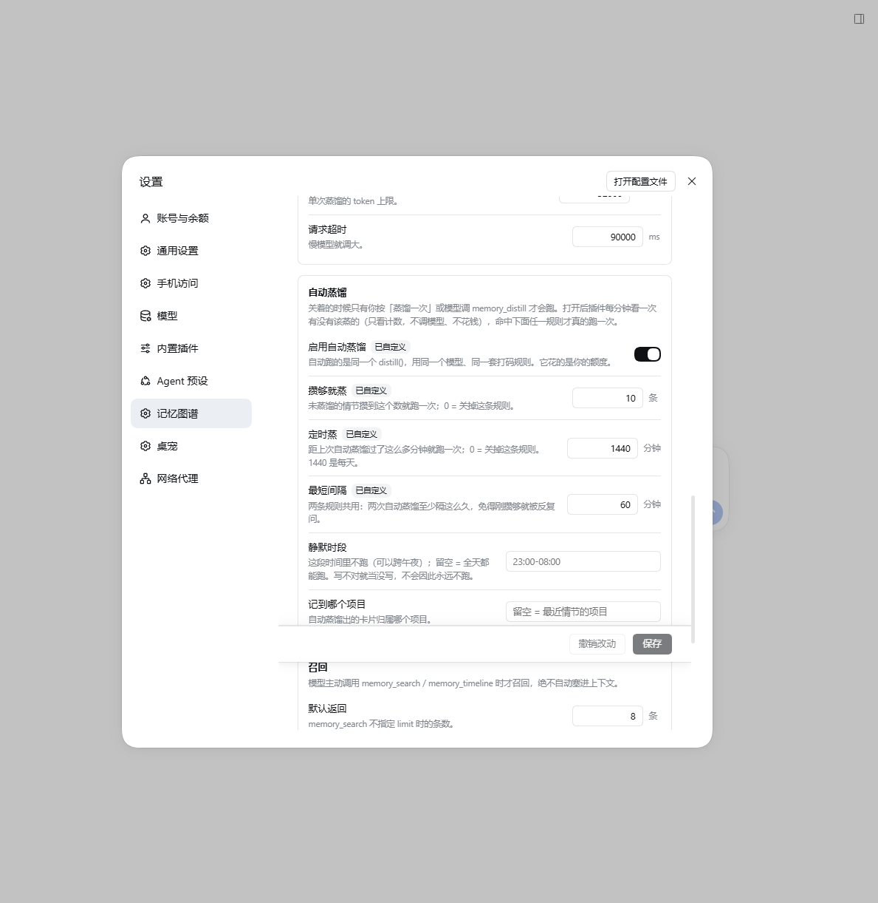
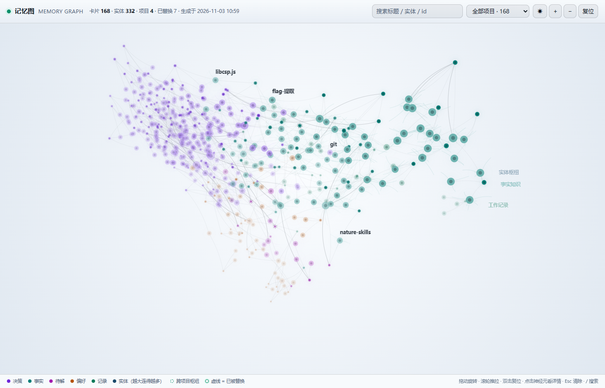
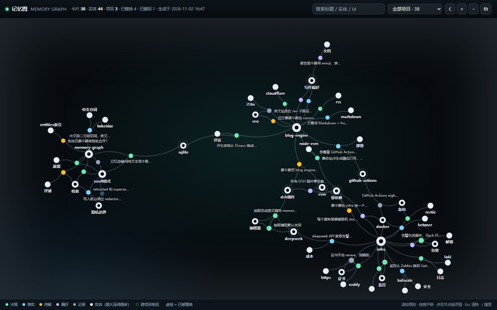
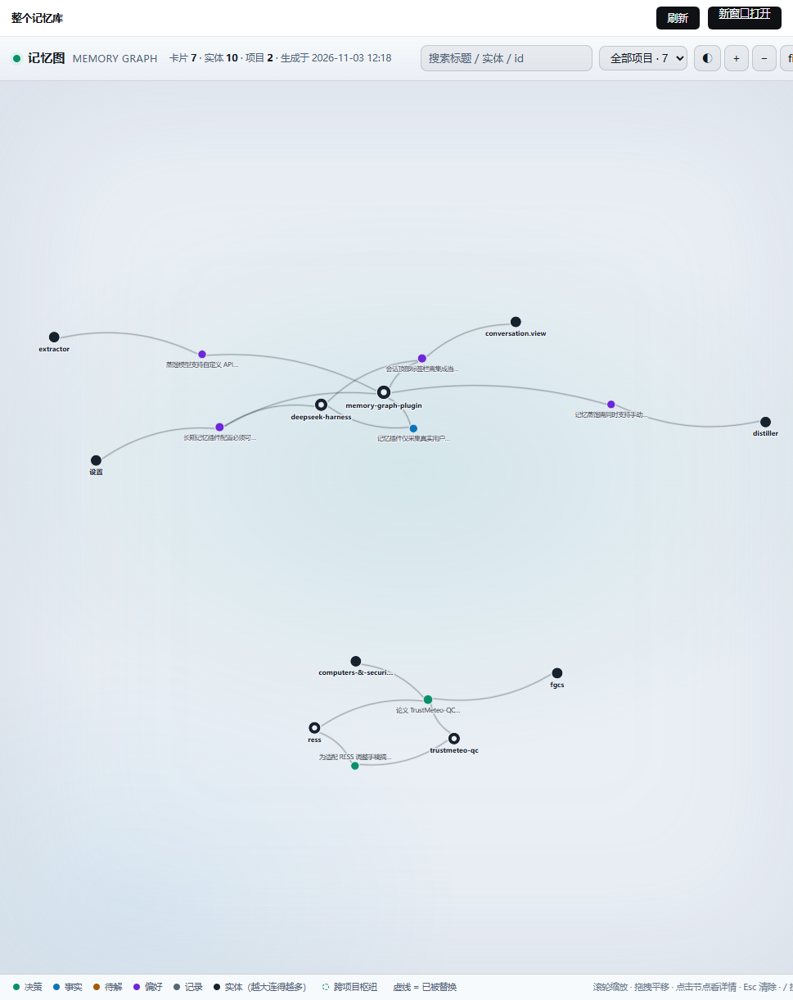
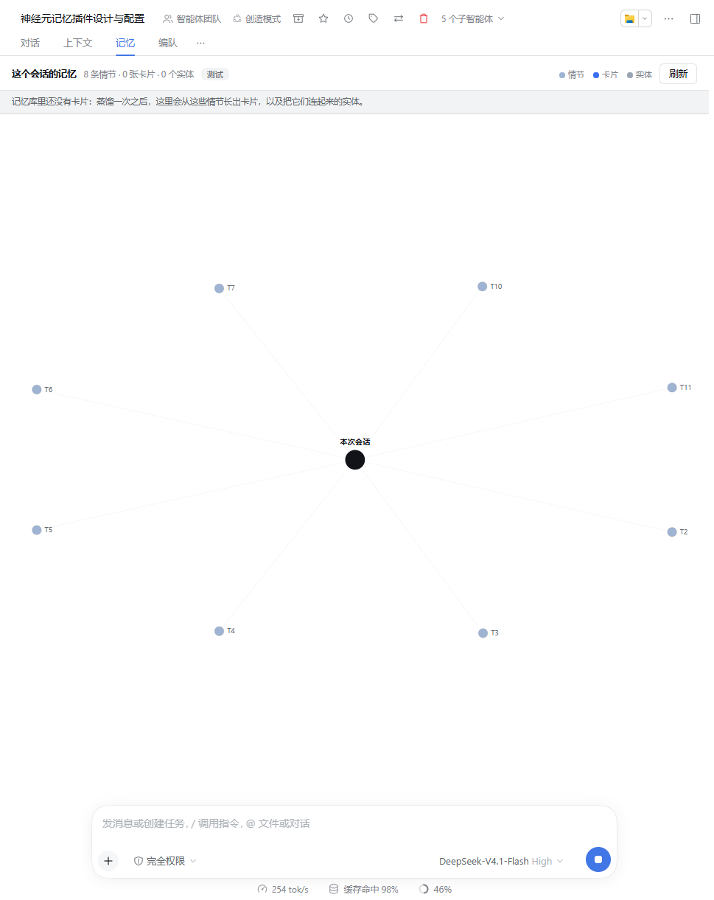
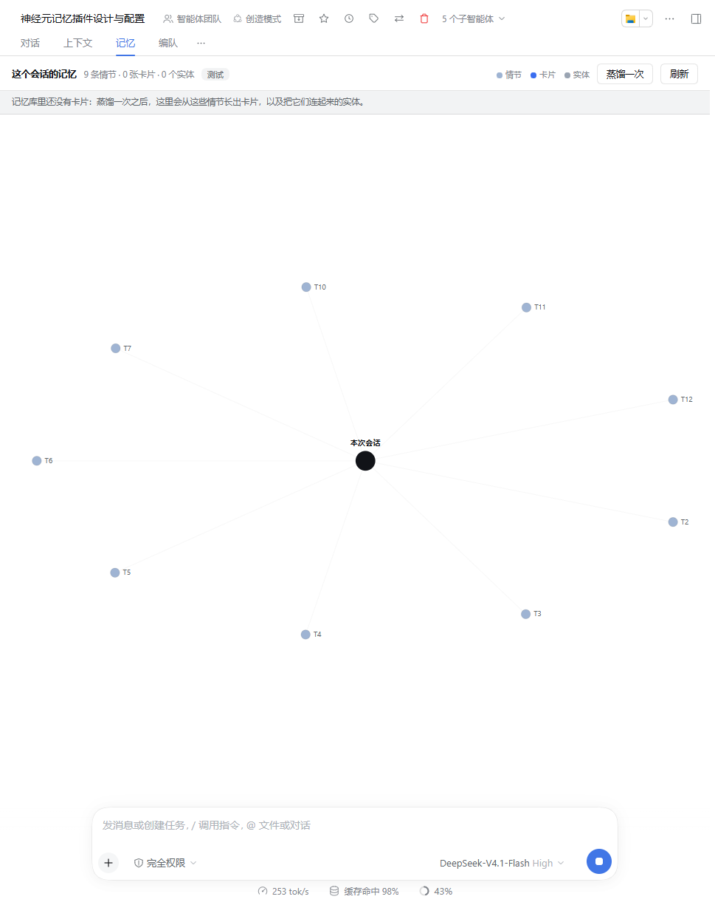
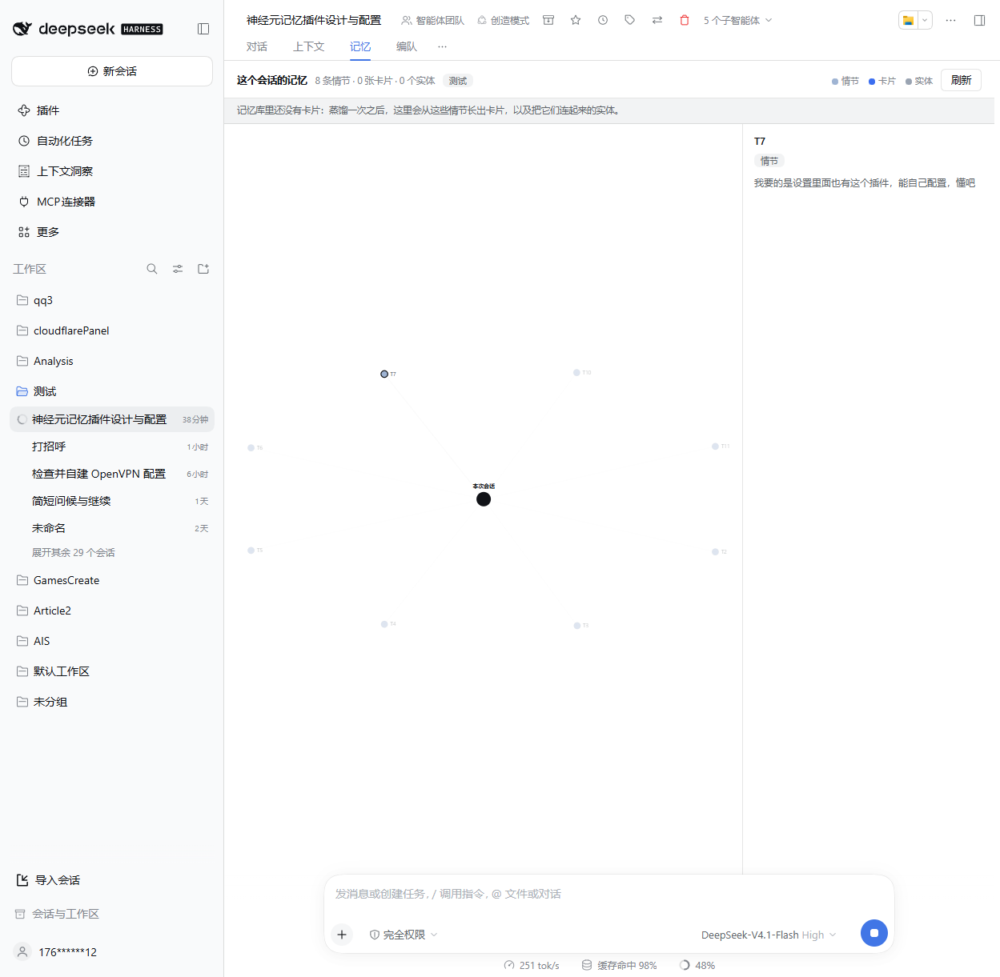
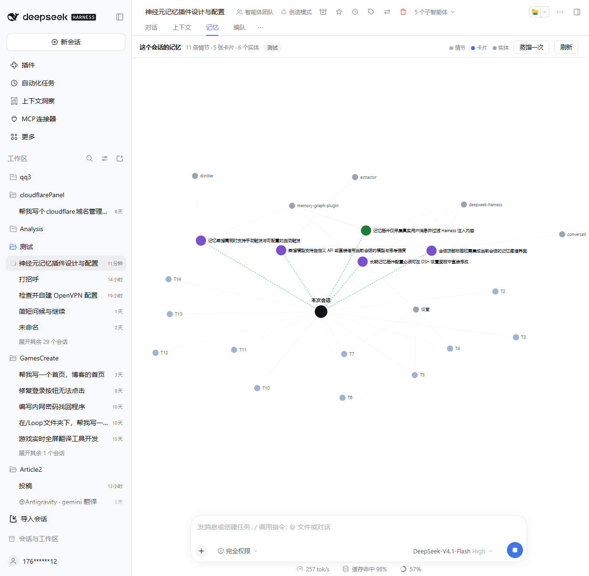

# dsh-memory-graph

[English](README.en.md) · 中文

[](https://www.npmjs.com/package/@ilaomianyang/dsh-memory-graph) [](https://github.com/ilaomianyang/dsh-memory-graph/actions/workflows/test.yml)

给 DeepSeek Harness 的**长期联想记忆**插件。上下文压缩会把东西真的抹掉；这个插件在上下文之外留一层持久的、可读的、属于你自己的记忆。

配置在 **设置 → 记忆图谱** 里，一页四组，改完即生效；看的时候有三个地方——**会话页签里的「记忆」**画出这个会话记住了什么，记忆库根目录的 graph.html 画出整个库，**左侧栏的「记忆图谱」**把同一张整库图直接搬进应用里。

纯 Node ESM，不需要构建。唯一的运行依赖是 Harness 自带的 `@deepseek-ai/schemastery`——它提供配置的 schema，设置页读的就是它投影出来的那份值；没装这个依赖时插件照常跑，只是「记忆图谱」这一页不会出现在侧栏。

---

## 它和"压缩上下文"有什么不同

| | 上下文压缩 | 本插件 |
| --- | --- | --- |
| 目的 | 让当前对话塞得进窗口 | 让三个月前的决定还能被找回 |
| 丢失 | 压掉就是没了 | 原始事件永不被改写，只追加 |
| 结构 | 一段摘要 | 带类型、带时间、带来源的卡片 + 实体连接 |
| 变化 | 不可见 | 冲突变成 supersede 链，"怎么变成现在这样"可读 |
| 位置 | 会话日志内部 | 独立文件夹，可移植、可直接读 |

一句话：**压缩是工作记忆策略，这个插件是长期记忆。两者不是替代关系，是并存的。**

## 三层结构

```
episodes/   原始层  每轮追加一行 JSON，不蒸馏、不删除           ← 保证"不会消失"
cards/      语义层  从原始层蒸馏出的带类型记忆卡片（markdown）  ← 真正的检索对象
entities/   索引层  每个东西一页，带提及时间线                  ← 跨项目联想的桥
```

模型检索的时候，走的是 `cards + entities`；`episodes` 是蒸馏的原料，也是出事时的对账依据。

### 卡片长这样

```markdown
---
id: "c-20261102-7f3a"
kind: "decision"
title: "记忆存储用纯文本文件而不是 SQLite"
project: "memory-graph"
entities: ["vault格式", "sqlite"]
created: "2026-11-02T15:40:12+08:00"
valid_from: "2026-11-02"
valid_to: null
status: "active"
confidence: "user_stated"
source: {"kind":"agent","project":"memory-graph"}
supersedes: []
tags: []
---
SQLite 需要处理锁和二进制合并，纯文本可以直接读、直接 grep、直接备份。
用户要求插件可以放到 GitHub 上让别人安装，纯文本降低理解成本。
```

`status` 只会是 `active` / `superseded` / `retracted`。**被推翻的记忆不会被删掉**，它变成 `superseded` 并指向新卡片——这正是"事物的发展"能被读出来的原因。

## 安装

**从 npm 装**（不用碰 GitHub）：

```
plugin_manager action=install_bundle target="@ilaomianyang/dsh-memory-graph"
```

pnpm 会把唯一的依赖 `@deepseek-ai/schemastery` 一起装好。国内装不动的话，给 `install_bundle` 加 `registry="https://registry.npmmirror.com/"`——npmmirror 会自动同步 npm 上的版本，通常是发布后几分钟到几小时。

**从源码装**（想跟着改的时候）：

```
git clone https://github.com/ilaomianyang/dsh-memory-graph
cd dsh-memory-graph
npm install                 # 只有一个依赖，Harness 自带的 schema 库
```

然后在 Harness 里让模型执行，或者自己在插件管理里填那个目录的绝对路径：

```
plugin_manager action=install_bundle target="<clone 下来的绝对路径>"
```

这条路 `install_bundle` 用 `link:` 方式装本地目录，**不会**替你装依赖，所以上面那步 `npm install` 别跳过。不装也能用，只是设置里看不到那一页。

想跟着改：`git pull` 之后重载插件即可（`plugin_manager action=set_plugin target="include:memory-graph" enabled=false`，再 `enabled=true`）。

**装完要重启一次 Harness**（关掉窗口重开）。原因不是偷懒：Web 侧的插件清单是启动时扫一遍运行中的 loader 条目、读各自 `package.json` 的 `dsh.client` 字段定下的，这份扫描结果在进程里有缓存，之后不会再读第二遍。所以新装、或者改了 `client.js` / `package.json`，都得让进程重来一次；装完不重启，侧栏里不会有「记忆图谱」，而你手上不会有任何报错提示。

重启后打开 **设置 → 记忆图谱**（在「模型」和「内置插件」之间）。卸载：`plugin_manager action=remove_bundle target="@ilaomianyang/dsh-memory-graph"`。**记忆库不会被删**，它在 `~/dsh-memory`，独立于插件。

## 你的记忆库长什么样

```
~/dsh-memory/
├── vault.json                     库的元信息（schema 版本、创建时间）
├── projects.json                  见到过的项目 slug
├── README.md                      自动生成的目录页，链接到每张卡片
├── graph.html                     自动生成的记忆图，双击打开（应用里也有同一个）
├── episodes/2026-11-02.jsonl      原始层：一轮一行，只追加
├── cards/2026-11/                语义层：一个文件一张卡片
│   └── c-20261102-7f3a.md
├── entities/                     索引层：一个东西一页
│   └── vault格式.md
└── audit/2026-11.log             隐私拦截的审计（只记规则，不记内容）
```

纯文本、一文件一记忆、只追加不重写——可以 `git init` 自己版本化，或者直接 `grep -r` 全库搜索。这是本地私有数据，只属于你一个人；共享出去的是这个插件项目，不是记忆库。

## 配置

**设置 → 记忆图谱**。这个插件在 Settings 的侧栏里自带一页，四组：采集 / 隐私 / 抽取器 / 检索。每项都有中英文说明，改完按「保存」即时生效，不用重启、不用重载。

- 改过的字段带「已改」标记，点旁边的「恢复默认」退回默认值（不是清空成空串）。
- 保存被拒会直接说原因（数字越界、宿主刚被别处改过），不会悄悄吞掉。
- 抽取器那一组跟着你选的路线走：`transport` 选 `harness` 只看模型相关的几项，选 `http` 才出现 endpoint / key。

**四个不在这页上的键**：总开关 `enabled`、记忆库目录 `vaultDir`、默认项目名 `defaultProject`、跨项目连接 `crossProject`。它们在插件启动时就被读掉了（决定库在哪、按哪个项目归档、要不要连跨项目实体），改它们要重载插件，所以留在 profile 的 `cordis.patch.yml` 里手写。同一行的 `config` 下也能写页面上的那些项——**YAML 是最终事实**，两边改都行：

```yaml
- id: memory-graph
  config:
    vaultDir: '~/dsh-memory'
    capture:
      enabled: true
      userChars: 1500
      assistantChars: 1500
    privacy:
      redactEmails: true
      redactPaths: true
      denyPatterns: ['我的内部域名\\.corp']
    extractor:
      enabled: true
      transport: 'harness'      # 默认：跟随设置里选中的模型，不用自己配 key
      maxEpisodesPerRun: 40
    retrieval:
      limit: 8
      hops: 1
```

| 键 | 默认 | 说明 | 在设置页 |
| --- | --- | --- | --- |
| `enabled` | `true` | 总开关，关掉就是彻底不加载 | — |
| `vaultDir` | `~/dsh-memory` | 记忆库位置，支持 `~` | — |
| `defaultProject` | `shared` | 会话没有 cwd 时归档到哪个项目 | — |
| `crossProject` | `true` | 新卡片是否连进项目实体枢纽 | — |
| `capture.enabled` | `true` | 是否自动追加原始事件 | ✓ |
| `capture.userChars` | `1500` | 你每条消息最多存多少字，超出截断 | ✓ |
| `capture.assistantChars` | `1500` | 助手每条回复最多存多少字 | ✓ |
| `capture.includeToolOutput` | `false` | 是否记录工具名与调用次数（**不记录内容**） | ✓ |
| `capture.minChars` | `12` | 短于这个字数的轮次不入库（"好""继续"这类） | ✓ |
| `capture.skipPatterns` | 3 条内置 | 老版本日志没有来源标记时的兜底正则 | ✓ |
| `privacy.useDefaultPatterns` | `true` | 内置密钥/私钥/token 规则 | ✓ |
| `privacy.denyPatterns` | `[]` | 追加你自己的正则，支持 `(?i)` 前缀 | ✓ |
| `privacy.redactEmails` | `true` | 邮箱替换成 `[email]` | ✓ |
| `privacy.redactPaths` | `true` | 家目录替换成 `~` | ✓ |
| `extractor.enabled` | `false` | 关闭时只采集不蒸馏，不产生任何模型调用 | ✓ |
| `extractor.transport` | `harness` | `harness` = 借用设置里的模型；`http` = 自己填 endpoint 直连 | ✓ |
| `extractor.useCurrentModel` | `true` | harness 模式下是否跟随当前选中的模型 | ✓ |
| `extractor.provider` | `''` | harness 模式：关掉「跟随」后指定提供商 id | ✓ |
| `extractor.reasoningEffort` | `''` | harness 模式：思考强度，留空则沿用设置里的那一档 | ✓ |
| `extractor.maxEpisodesPerRun` | `40` | 一次蒸馏最多喂多少条情节 | ✓ |
| `extractor.maxOutputTokens` | `3000` | 单次蒸馏输出上限 | ✓ |
| `extractor.timeoutMs` | `90000` | 单次调用超时 | ✓ |
| `extractor.baseUrl` | `https://api.deepseek.com/v1` | http 模式：任何 OpenAI 兼容端点 | ✓（http） |
| `extractor.path` | `/chat/completions` | http 模式：路径 | ✓（http） |
| `extractor.model` | `''` | 模型 id；http 模式留空即 `deepseek-chat` | ✓（http） |
| `extractor.apiKeyEnv` | `MEMORY_LLM_API_KEY` | http 模式：key 从这个环境变量名的来源里找 | ✓（http） |
| `extractor.apiKey` | `''` | http 模式：直接写 key（不推荐，见下） | ✓（http） |
| `extractor.temperature` | `0.1` | 仅 http 模式：harness 模式下采样由被借用的模型设置决定 | ✓（http） |
| `auto.enabled` | `false` | 自动蒸馏总开关；关着只有按钮和工具能跑 | ✓ |
| `auto.minEpisodes` | `0` | 未蒸馏情节攒到这个数就跑一次；0 = 关掉这条规则 | ✓ |
| `auto.everyMinutes` | `0` | 距上次过了多少分钟就跑一次；0 = 关掉这条规则 | ✓ |
| `auto.minGapMinutes` | `30` | 两条规则共用：两次自动蒸馏至少隔多久 | ✓ |
| `auto.quietHours` | `''` | 不跑的时间段（如 `23:00-08:00`，可跨午夜） | ✓ |
| `auto.project` | `''` | 自动蒸馏出的卡片记到哪个项目 | ✓ |
| `retrieval.limit` | `8` | 一次检索最多返回几张卡片 | ✓ |
| `retrieval.hops` | `1` | 联想扩散跳数，0 = 只做关键词 | ✓ |
| `retrieval.snippetChars` | `320` | 每条结果给模型看多少字摘要 | ✓ |
| `retrieval.timelineLimit` | `20` | `memory_timeline` 默认回看多少条 | ✓ |

为什么只有这 34 个能在这页改？Harness 的设置机制只投影**声明为 volatile 的字段**，也就是"每次用到时才读"的那些。上面带 ✓ 的都是这种：改一次，下一次调用就换了。而 `enabled` / `vaultDir` / `defaultProject` / `crossProject` 是在激活时消费的，改了得重载插件，所以不放进页面装样子——页面底部会直接把这件事写出来，而不是给你几个点了没反应的开关。

### 什么时候它会自己蒸：两条规则

默认**不自动**。打开 `auto.enabled` 之后，插件每分钟看一次「现在该不该蒸」——这一眼只做算术（未蒸馏条数、距上次多久、是不是静默时段），**不调模型、不花钱**。命中规则才真的跑一次，跑的还是同一个 `distill()`。

两条规则互相独立，可以只开一条，也可以都开：

| 规则 | 配置 | 什么时候触发 |
| --- | --- | --- |
| 攒够就蒸 | `auto.minEpisodes` | 未蒸馏情节 ≥ 这个数（比如 10 条） |
| 定时蒸 | `auto.everyMinutes` | 距上次自动蒸馏 ≥ 这么多分钟（1440 = 每天一次） |

另外三个闸门，两条规则共用：

- `auto.minGapMinutes`（默认 30）：两次自动蒸馏至少隔这么久。它先于两条规则判断——刚攒够就被反复问是没意义的，而且每次问都要花钱。
- `auto.quietHours`（默认空）：这段时间里不跑，可以跨午夜（`23:00-08:00`）。写不对就当没写，不会因此永远不跑。
- `auto.project`（默认空）：自动蒸出来的卡片记到哪个项目；留空用最近那条情节的项目。

几个刻意的选择：

- **定时蒸的时钟从打开那一刻算起**：刚打开不会立刻跑一次——「每天一次」不该在你按下开关的瞬间就花掉一次调用。时钟单独存（`startedAt`），不当作"上次运行"，所以它不会顺带把「攒够就蒸」推迟一个最短间隔。
- **间隔在调用之前就记下**，所以一次跑空了（没有新卡片）也算数，不会因为"没产出"而在下一分钟再问一遍。记录在库里的 `.auto-state.json`（只有 `lastAttemptAt`），**重启不重置**。
- 它和 `.distill-state.json` 是两件事：后者是**游标**（哪些行已经读过），前者是**尝试时间**。混在一起会让"读过了但没产出"变得无法表达。
- 自动、按钮、`memory_distill` 共用**一把锁**：正在跑的时候，第二条路拿到的是"已经有一次在跑"，不会排队、不会两份一起花。
- 想关掉：`auto.enabled=false`（总开关），或者把两条规则都设 0（留着开关但没规则，等于不跑）。



上面这张是真机：总开关开着，攒够 10 条就跑、每天补一次、两次之间至少隔 60 分钟，静默时段留空。改完点保存，下一拍就按新值判断——不用重载插件，也不用重启。

### 一次蒸馏会分几批

`maxEpisodesPerRun` 是**一次蒸馏最多读多少条情节**，不是一次模型调用喂多少条。插件按 `maxOutputTokens` 折算每批条数（约 320 输出 token 一条情节），一批一次调用、批批独立落盘：40 条情节是五次左右的小调用，而不是一次要 40 张卡的巨型调用。

两个原因：一是答案要装得进输出上限，二是某一批失败（限流、超时、网络断）时，前面几批的卡片已经写进库里、蒸馏游标也标好了，重跑只补剩下的。真遇到某一批仍然被截断，插件把它对半拆开重试；只剩一条还截断才是真失败，会照实报错（`maxOutputTokens` 那句话）。

`memory_distill` 的 `dryRun` 只跑第一批并报出还剩几条——预览不该把你的额度烧在整摞情节上。


### 抽取器接在哪：两条路

**A. 跟随设置里的模型（默认）**

`transport: 'harness'` 时，插件不碰 key、不碰 endpoint，直接向 Harness 的 `llm` 服务要一次调用，用的是你在 **Settings → 模型** 里选中的那一路：提供商、模型、思考强度（thinking）全部照搬。你在设置里给模型配过 key 了，插件就不用再要第二个。

- 想换抽取用的模型？在设置里换，插件下一次蒸馏就跟上。
- 想固定一个便宜的小模型专门做抽取？把 `useCurrentModel` 关掉，填 `provider` + `model`（例如 `deepseek` / `deepseek-chat`），key 仍然是设置里那套。
- 想跑更省或更强的思考档？填 `reasoningEffort`，取值是那个模型在设置里给出的档位 id（如 `high`）；留空就沿用设置里的选择。
- 这条路上没有密钥可泄露：插件全程只报"用了哪个提供商/模型/档位"，不接触凭据值。

**B. 自己填 endpoint 直连（`http`）**

抽取器完全独立，用自己的端点、模型和额度。适合：抽取想用一个别处的小模型、想接到自建网关、或者这个 Harness 构建里没有暴露 `llm` 服务。

设置页里也有 `extractor.apiKey` 一栏（密码框，不回显已存的值），但你**最好别用它**：填进去的值会明文落进 profile 的配置里。用 `apiKeyEnv` 指个名字、把值放进环境变量或 `~/.dsh/.credentials.yaml`，是这个插件设计上的默认路线。

### http 模式的 key 从哪来

按这个顺序找，找到就用，一路都不写进日志、不写进审计、不写进记忆库：

1. 配置里的 `extractor.apiKey`（不推荐，会落到 YAML 里）
2. 进程环境变量 `extractor.apiKeyEnv` 指定的那个名字
3. **Harness 自己的凭据库** `~/.dsh/.credentials.yaml` 里 `refs.<apiKeyEnv>` 指向的条目

第 3 条的意思是：如果你已经把 key 配给 Harness 用（比如 `DEEPSEEK_API_KEY`），把 `apiKeyEnv` 改成同名就行，不用再导出环境变量。读凭据库时只解析 `refs:` 那一段，别的内容不碰。`memory_stats` 会告诉你这次蒸馏走的是哪条路、用的哪个模型（`extractor:` 那一行），但永远只报来源、不报值。

## 工具

| 工具 | 作用 |
| --- | --- |
| `memory_search` | 跨项目检索，返回 id + 摘要 + 命中原因 |
| `memory_get` | 读一张卡片的全文和关联实体 |
| `memory_timeline` | 按时间看，保留 supersede 链 |
| `memory_graph` | 从一个实体或卡片出发，看它连着哪些记忆和邻近实体 |
| `memory_remember` | 显式写一张卡片 |
| `memory_forget` | `retract` 撤回（留痕）或 `purge` 删除 |
| `memory_distill` | 用抽取模型把原始事件蒸馏成卡片 |
| `memory_stats` | 库位置、数量、上次蒸馏时间 |

`memory_graph` 是"神经元"那部分的具体形态：边不是凭空生成的，而是**两张卡片提到同一个实体**。它不声称因果，只声称"这两个东西在同一段记忆里出现过"，模型看到之后自己判断。

**没有自动注入。** 记忆只在模型主动调用工具时才进入上下文——这是刻意的：大多数轮次根本不需要长期记忆，注入了就是纯成本。

## 看一眼你的记忆

`memory_stats` 会告诉你库在哪；库里根目录还有一个 **`graph.html`**，双击就能开，不用装东西、不用起服务：



- **实体是深色大枢纽**（`infra`、`deepseek`、`blog-engine`、`memory-graph`……），大小按被提及次数长，跨项目共享的实体一眼就能认出来。
- **卡片是彩色小点**，颜色是 kind：决策 / 事实 / 待解 / 偏好 / 记录。
- **虚线 = 已被替换**（`superseded`），能看见「改口」发生过的位置；撤回的卡片仍在，只是灰掉。
- 搜标题 / 实体 / id、按项目过滤、点卡片看详情、悬停高亮一跳邻居、滚轮缩放、拖背景平移、`Esc` 清除。
- 跟随系统深浅色；也可以直接跳到 `#dark`、`#light`，或者 `#dark&<卡片id|实体slug>` 一次把主题和某张卡片都定好。
- 每次 `memory_remember` / `memory_forget` / `memory_distill` 之后自动重画；空库和只有一张卡的库都有能读的提示，不会白屏。

它是**一个自包含的 HTML 文件**：没有 CDN、没有框架、没有构建步骤、没有网络请求，数据是渲染时内联进去的。38 张卡片 → 101 KB。丢掉它也无所谓，下次写入会重新生成。

深色：



一个明确的边界：`graph.html` 是**整个库**的静态快照，双击就开、不依赖 harness。会话里"这个会话记住了什么"是另一张图，见下一节。

### 不用找文件：侧栏里的「记忆图谱」

不想翻记忆库目录的话，插件在应用左侧栏注册了一个**「记忆图谱」**入口（和 插件 / 自动化任务 / 上下文洞察 同一列），点开就是上面这张整库图：

- 面板里嵌的是同一个 `graph.html`，走宿主自己的 `/api/memory-graph.page` 路由——**同一份渲染器**，不是第二套实现，所以面板里有的搜索/过滤/悬停，双击文件打开的那个也一定有，反过来也一样。
- 顶栏两个按钮：**刷新**（重画，读到刚写进去的卡片）、**新窗口打开**（拿这个页面开一个真正的浏览器窗口，图能占满屏）。
- 只读、不花钱：这条路由只读磁盘上的卡片和实体页，不写文件、不调模型。`X-Frame-Options: SAMEORIGIN`，所以只有应用自己能把它嵌进去。
- 记忆库目录**不会**出现在浏览器里——面板拿的是路由，不是文件路径。



## GUI 里的「记忆」页签

会话页签那一行（对话 / 上下文 / 编队 / …）里多了一格「记忆」。它只画**这个会话**：

- 中间的深色点是本次会话；从它伸出去的浅蓝点是这个会话写下的每条情节（`T1`、`T2`……）。
- **绿色虚线**是这个会话自己的话真的能唤回的卡片——用的是 `memory_search` 同一个函数，所以图上亮着的就是模型查"你还记得吗"时真会拿到的东西。
- 灰色点是实体，卡片和实体之间是"这张卡提到它"，情节和实体之间是"这一轮的话里出现了它"。
- 跨项目的卡片通过共享实体挂进来（虚线边框、暗一档）：这是实体层唯一的存在理由，所以它在图上是看得见的。
- 点任意节点，右侧展开它的全文；点空白处收起。页头有计数、项目、跨项目数、一个**蒸馏一次**按钮和一个刷新按钮；页签开着时每 20 秒静默重取一次。
- **蒸馏一次**就是手动跑那一次蒸馏：走的是 `memory_distill` 工具背后同一个 `distill()`，用你在设置里选中的模型，跑完把「读出 N 条情节 → M 张卡片」写在页头下面，随即重画图。采集是随手记；蒸馏有三条路：你按这个按钮、模型自己调 `memory_distill`、或者按下面的规则自动跑——三条路走同一把锁，永远不会同时跑两份。



右上角两个按钮：**蒸馏一次** 和 **刷新**。



点开一个情节，右侧就是那一轮你自己说的话：



前面那张是记忆库还没蒸馏过的样子——只有情节，没有卡片和实体，面板顶上那句提示就是在说这件事。按下「蒸馏一次」之后，同一个会话变成这样：紫色是卡片，灰色是实体，中间那团是本次会话，虚线是「这条记忆是在这里被说出来的」：



图上的卡片就是这个会话里蒸馏出来的东西——包括你提的那几条需求本身。

数据不是塞进页面里的：宿主注册了两条 exact Fetch route——`/api/memory-graph.graph`（GET，读这一个会话的图）和 `/api/memory-graph.distill`（POST，按一下才有、跑一次蒸馏）——harness 的 Connection 先验浏览器的签名、只放行 owner Peer，浏览器拿自己已有的 cookie 请求即可。插件里没有第二套鉴权，也没有把库目录暴露给页面；蒸馏那条只收 POST，所以刷新页面或预取都不可能顺手花掉一次模型调用。布局是在**宿主**算的（确定性力导向），浏览器只负责把坐标画出来，所以重开页签是同一张图。

上限：情节 40、卡片 60、实体 40、跨项目 12、边 420。超了页头会照实报总数，图只画最近的这些——一张图看不清的时候，它就没用了。

> 改完怎么生效：`client.js` 刷新页面就行（宿主每次请求现读这个文件）；改了宿主侧（`index.js` / `src/*.js`）要在插件管理器里把「记忆图谱」关掉再打开，它会重新 `apply`，不用重启整个应用。

## 跨项目是什么意思

同一个人的多个项目之间互相联想，不是多人共享记忆。

你在 A 项目里定过"所有脚本必须零依赖"，三个月后在 B 项目里问"这个库能不能省掉构建步骤"，`memory_search` 会把 A 项目那张卡片带出来——因为它们共享实体 `零依赖`。这就是实体层存在的唯一原因。

## 隐私

写入前拦截，不是写完再清：

- 内置规则：各类 API key、私钥块、`password=` 形态、Bearer token
- `redactEmails`：邮箱 → `[email]`
- `redactPaths`：家目录 → `~`
- `denyPatterns`：你自己的正则

命中即替换为 `[REDACTED]`，审计日志只记录"哪条规则触发"，**不记录命中内容**。万一有东西漏进来，`memory_forget mode=purge` 直接删文件。

### 只记你说的话

Harness 会把运行时快照、技能目录、时间戳、审批通知、压缩摘要**伪装成 user 消息**投递进来。这些不是你的话，蒸馏它们只会凭空造出记忆。

所以采集看两件事，**两条都过一遍**：`source.kind`（不是 `user` 就丢）和 `capture.skipPatterns` 的文本正则。

为什么两条都要看，而不是只看来源：来源不是每次都可靠——实测库里就躺过一条 1501 字的图像工具说明，它带的正是 `kind: 'user'`，于是被当成你说的话记了下来。来源只能**增加**跳过，不能否决文本规则。

判断之前，先剥掉有边界的那种注入（`<system-reminder>…</system-reminder>`）。这样一条真的消息里带了提醒时，剥完留下的是你的原话，而不是整条被丢掉。

顺带的好处：一轮里不再被中途插入的注入消息切断，情节的边界就是真正的轮次边界。

#### 两个已知限制

- **不回溯**。采集只从插件在场那一刻开始（这个库里第一条情节是 2026-11-02 15:53，就是插件第一次被启用的时间）。更早的会话一条情节都没有，插件也不会去读历史会话记录——记忆从你装上它的那一刻起长。
- **子智能体会话也会被记**。我派出去干活的子智能体，它们的开场提示词会被当成一条情节（项目名按 cwd 推断）。这些是内部指令，不是你的记忆；目前没有过滤，看到就是一条噪音。

## 设计取舍（重要的几条）

1. **实体层是跨项目的关键**。两个项目共享"同一个 Postgres 实例""同一个工具"，通过 entity 页连起来，而不是靠向量相似度碰运气。
2. **时间有效性 `[valid_from, valid_to]`**。没有它，记忆图会把三个月前的方案和昨天的方案平铺在一起，安静地撒谎。
3. **写入是情节，不是事实**。`episodes` 记"什么时候、因为什么、谁决定"；`cards` 是从情节派生的结论。
4. **遗忘是功能**。`retract` 保留痕迹，比假装没发生诚实；`purge` 才是真删。
5. **图是派生缓存**。会话日志是唯一真相源，卡片全部可以从 episodes 重新蒸馏出来。

## 测试

零依赖，不联网，不碰真实记忆库：

```bash
npm test        # 43 + 13 + 35 + 12 + 22 + 54 + 15 + 7 + 11 + 19 = 231 项检查，另加 25 题检索评测
npm run eval    # 只跑检索评测（离线，确定性的）
```

- `test/smoke.mjs` — 存储、隐私过滤、BM25 检索、实体扩散、supersede 链、蒸馏结果解析；另外验证近义标题不会在图上分叉（同一张卡换了措辞 → 归一化到老卡、正文取更全的那份、不跨项目；写了 `supersedes` 的推翻不被当成重复）
- `test/schema.mjs` — 设置页和运行时不许漂移：双向比对 `Config({})` 和 `resolveConfig({})` 的每个叶子（只有 `vaultDir` 例外，页面存原始文本、运行时存绝对路径）——页面多一格没用的、少一格看不见的都算失败；另外验证 `transport` 只认那两个值、数值边界、`apiKey` 被标成 secret、volatile 叶子数量正好等于页面的字段表（多一格少一格都失败）、四个结构键不许出现在页面字段表里
- `test/client.mjs` — 把设置页挂在一个够用的 React 替身上跑：页面画出的控件 = 该显示的字段、切换 `transport` 后 http 那几项才出现、空的内联 key 不会被当成"删除"发出去、越界的数字到不了线上、宿主拒绝后清空草稿并报错、「恢复默认」发的是 `unset` 而不是 `set`、只在真的和继承值不同时才打「已自定义」（同一次保存会钉住整行，值等于默认的不算改过）、样式表只有一个带包名标记的 `<style>`、`client.js` 里不许出现 `export`/`import`（loader 按脚本求值）；再把 `client.js` 真的放进一个带 `window.__ModuleLoader__` 的假页面里求值，走一遍 factory → `apply` 的浏览器路径（只 `require('react')`、注册 id 是包名、四处 order 分别 25 / 30 / 30、标签跟随页面语言、动作栏是滚动区的兄弟而不是它里面的 sticky 子元素）；再验证**侧栏入口 + 主面板**（`sidebar.panellist` 与 `main` 用同一个 id 才连得上、面板里嵌的是那条路由而不是第二套渲染、src 里不带库路径）；最后驱动**会话页签**：只按 `sessionId` 请求 `/api/memory-graph.graph`、宿主给的节点和边一个不少地画出来、点卡片在右侧展开标题与正文、点空白收起、空会话和失败的路由都给人话
- `test/graphdata.mjs` — 会话页签的数据：按 `session` 过滤情节（别的会话一条都不带）、项目多数决、召回查询取最近几轮并截断、布局确定且不越界、每条边都指向存在的节点、跨项目卡片通过共享实体挂进来、上限与截断照实报、assistant 原文不进 payload；路由对"缺 session / 正常 / 库坏掉"三种情况分别回 400 / 200 / 500
- `test/capture.mjs` — 用真实的 `session/event` 形状驱动采集，验证一轮一情节、密钥被拦、短轮不入库、注入消息不入库
- `test/tools.mjs` — 逐个跑 8 个工具的 `execute` + `render`；另外验证模型要的那次蒸馏走的是共享 runner（而不是绕开它直接调 `distill`），否则它可能和一次自动蒸馏撞在一起
- `test/page.mjs` — 侧栏面板背后那条路由：`/api/memory-graph.page` 在受认证通道上、空库也给一页而不是报错、**和落到磁盘的 `graph.html` 是同一份渲染**（只差时间戳）、`X-Frame-Options: SAMEORIGIN` 所以只有应用能嵌、库读坏了把原因印在页面上（转义后）、没有库是 500 不是崩溃、页面里不带任何库路径
- `test/distillapi.mjs` — 「蒸馏一次」那条路：`/api/memory-graph.distill` 在受认证的 `/api` 通道上、跑的是同一个 `distill()`（活库 + 设置里的模型 + 打码规则）、一次按下一次运行、并发第二次被拒（不排队）、抽取器的拒绝是 200 而不是 500、抛错是 500 且锁照样解开、写了卡片才重建视图、渲染失败只 warn、卡片列表截到 40、没有 runner 时回 500 而不是把异常扔给浏览器
- `test/auto.mjs` — 自动蒸馏：两条规则各自触发、都开时谁先满足谁先跑、最短间隔先于两条规则判断、静默时段跨午夜、tick 只做决定（关着时连库都不读）、一次 tick 最多一次运行、间隔在调用前就记下、重启后读回 `.auto-state.json` 所以不会重跑、跑空了也记间隔、正在跑时不叠加、失败照原因记日志、项目名透传、库读不了是跳过不是崩、阈值大时请求的条数够看到它
- `test/extract.mjs` — 抽取器：`fetch` 打桩验证 http 路线（提示词构造、key 解析顺序、JSON 解析容错、每张卡片归到自己的项目、游标前进、dry run 不落盘、密钥在写入前被拦住），再用一个假的 `llm` 服务验证 harness 路线（借用设置里的模型与思考档、显式覆盖、没有选中模型时的报错、`finish` 各种终态、取消、空回复、以及全程不碰 `fetch`），最后验证分批：按输出上限折算每批条数、长后台分多次调用、被截断就对半拆、某一批失败时前面几批的卡片留着、`dryRun` 只预览第一批

下面两个测试会真的联网/花钱，所以不在 `npm test` 里，要自己跑：

```bash
npm run live             # 真模型端到端：3 条情节 → 蒸馏 → 再检索回来
node test/live.mjs --backlog 12 --tokens 3000   # 12 条情节，看它真分成两批
node test/live.mjs --tokens 900                 # 输出上限压低，看它截断后对半拆
npm run live:supersede   # 真模型：先记一条，再让它被"更正"推翻，验证作废链
```

它们从 `~/.dsh/.credentials.yaml` 或环境变量取 key（见下文），不写死、不落盘。这两个脚本跑在普通 `node` 进程里，没有 Harness 的 `llm` 服务可借，所以它们显式用 `transport: 'http'`；插件自己在界面里默认走 harness。

## 发布

版本号只有一个来源：`package.json` 的 `version`。发一个版本就等于打一个 tag：

```bash
npm run release        # = npm version patch（先跑测试）→ 提交 → tag → git push --follow-tags
npm version minor -m "chore(release): v%s" && git push --follow-tags   # minor / major 换这个写法
```

推上去的 tag 会触发 `.github/workflows/publish.yml`，它只做四件事：

1. 核对 tag 和 `package.json` 的版本号——不一致就失败，不会发出一个版本号对不上的包；
2. 查这个版本是不是已经在注册表上——在就跳过，重推同一个 tag 是空操作而不是报错；
3. `npm publish --provenance --access public`（`prepublishOnly` 会再跑一遍那 231 项，红的进不去）；
4. npm 页面上多一条「Built and signed on GitHub Actions」，证明这个 tarball 是从这个仓库的这个提交构建的。

需要在仓库里配一个 secret：**Settings → Secrets and variables → Actions → New repository secret**，名字 `NPM_TOKEN`。内容必须是 **Automation** 类型的 token（npmjs.com → Access Tokens → Generate New Token → Automation）：账号开了 2FA 时，普通的 Publish token 会被 `403 ... two-factor authentication ... required to publish` 挡回来，Automation token 天生绕过它。这个 token 只给 CI 用，不要写进 `.npmrc`。

不想等 CI、或者 GitHub 那一刻连不上，就在本地发：

```bash
npm publish            # publishConfig 已经把 registry 钉在 npmjs，prepublishOnly 会跑测试
git push --follow-tags # 别忘推 tag，否则 CI 里没有这次发布的记录
```

手动发过之后，CI 那条会命中第 2 步的跳过分支，不会再发一次。

## 蒸馏实测（真模型跑过，不是估计）

用 `deepseek-chat`，`npm run live`：

| 输入 | 产出 | 耗时 | token |
| --- | --- | --- | --- |
| 3 条合成情节（中英混排，2 个项目） | 5 张卡片，项目归属 5/5 正确 | 2.9 s / 3.6 s（两次） | ≈1 590 |
| 真实会话日志 266 个事件 → 采出 2 条情节（1 501 + 278 字） | 9 张卡片（8 decision + 1 preference），中文进中文出 | 5.9 s | 2 816（prompt 1 795 / completion 1 021） |
| 12 条情节（同一段内容重复 4 轮，故意制造重复） | 分 2 批（9 + 3）→ 4 张卡片，第 2 批全是「重新确认」 | 5.9 s | 4 153（prompt 3 114 / completion 1 039） |

第一版是一次调用喂完所有待蒸馏情节。在真实记忆库上第一次跑就撞了墙：23 条情节要产出三十来张卡，3 000 输出 token 截断，整批白跑。现在按输出上限分批——**同一份后台，拆成几次小调用，反而更快也更抗失败**。

`npm run live:supersede` 验证的是**时间有效性真的会动**：第一轮记下「上传到 GitHub 共享」，第二轮用户更正「共享的是插件，不是记忆」，抽取模型自己填 `supersedes`，旧卡转 `superseded` 并写 `valid_to`，两边链接互指。这条链在离线测试里只能验证机制，验证不了模型会不会填。

顺带一个真实的教训：我第一次拿**旧快照**回放时，蒸馏出的卡片把"记忆要上传 GitHub 共享"当成了现行结论。查下来的原因不是模型错，是那份快照早于用户的更正——**记忆只能和它读到的东西一样好**。所以插件做的是：情节永远留着，卡片可被推翻（`supersedes`），推翻也可被查（`memory_timeline`）。

## 检索到底准不准

`eval/` 是一套离线评测：38 张卡片 / 3 个项目 / 5 种 kind / 7 个跨项目共享实体 / 4 条 supersede 链 / 1 张 retracted，25 道检索题（keyword 9、entity-bridge 6、temporal 5、negative 5）外加 4 对（8 条）「问历史 vs 问现状」成对题，跑仓库里真实的 `searchCards`，不自己写一套评分。题目是先写好的，跑完没有改过一个字。

```bash
npm run eval
```

当前结果（limit 5、hops 1）：

| 题型 | n | recall@1 | recall@5 | MRR |
| --- | --- | --- | --- | --- |
| keyword | 9 | 1.00 | 1.00 | 1.00 |
| entity-bridge | 6 | 0.67 | 0.94 | 0.83 |
| temporal | 5 | 0.60 | 1.00 | 0.80 |
| 历史成对（老卡 vs 继任卡） | 4 对 | — | — | 4/4 |
| negative（库里没有） | 5 | — | — | 误报 0/5 |
| 全部 | 25 | 0.80 | **0.98** | 0.90 |

**[`eval/REPORT.md`](eval/REPORT.md) 里写着这份评测没覆盖什么，以及八个已知弱点**——包括「问历史」「问现状」这类意图靠一条正则判断，同样是穷举（实测 10 条变体里仍会漏）；包括「监控之前那套还留着吗」这种问现状却把老卡排第一；包括 `部署`、`流程` 这种有主题义的常见词会让 negative 的判据停在灰区。0/5 只该读作"这 5 条过了"，不该读作"负面问题修好了"；4 对成对题只有 4 对，是抛硬币级别的证据。想信这个分数之前先读那份报告。

一处刻意的设计：**问历史有单独的通路**。「抽取模型现在默认开着吗」会压制作废的旧卡、把现行结论顶上来；「最早那版抽取方案是什么」则反过来，把作废卡还原到满权重。同一批词、不同的时态，答案不是一个——降权不该等于捞不出来。

## 已知边界

- 检索是关键词 BM25 + 实体扩散，**没有向量召回**。中英文混合场景下中文靠 bigram 分词，可用但不如嵌入模型；卡片量到几千张时应该换。
- 蒸馏质量取决于抽取模型，且**只在你显式调用时发生**，不会自己跑。建议配合定时任务。
- harness 模式借的是「设置里当前选中的那个模型」，所以你在对话里换模型，抽取也跟着换；想钉死一个抽取专用模型就把 `useCurrentModel` 关掉。另外它花的是同一个模型提供商的额度，不会因为"插件"就变免费。
- `graph.html` 是**静态 HTML**（整个库的快照）；会话页签里的「记忆」是 GUI 面板，但它只画**当前会话**那一小块，不是整库的交互图。侧栏的「记忆图谱」补上了这一块：它把整库图嵌进应用，但用的是 iframe + 那条只读路由，搜索/缩放/过滤仍然是页面自己的那套，不是 React 重画。——整库的缩放/搜索/过滤仍然在 `graph.html` 里。
- 会话页签的数据来自两条 `/api/memory-graph.*` 路由，所以它需要一个能跑 Web GUI 的环境；headless / CLI 配置下插件照常工作，只是没有这个页签。改了 `client.js` 刷新页面即可，改了宿主侧要重新 `apply`（插件管理器里关掉再打开）。
- 卡片去重先是"同项目 + 标题归一化相同"，再放宽到标题的**词面重合度 ≥ 0.55**（用的是检索那套 bigram 分词；实测无关卡片最高 0.20，同一件事换个措辞 0.60–0.78）。所以「蒸馏走独立模型接口」和「蒸馏用独立模型接口」现在是一张卡，不会在图上分叉。但**写了 `supersedes` 的卡片跳过这层判断**——「监控换成 Prometheus」和「监控换到 Uptime Kuma」词面再像也是新决定。语义相反、措辞又差得远的仍会存成两张：这层只做词面近似，不读意思。
- 设置页是四张写死的分组卡片 + 一张手写字段表，不是对 schema 的通用反射；`test/schema.mjs` 负责保证两边一致——改了 schema 却忘了改字段表，结果是测试挂掉，而不是页面上多出一个控件。`skipPatterns` / `denyPatterns` 仍然是多行文本框一行一条。
- 页面**不轮询**：配置在别处（手改 YAML、另一个窗口）被改过之后，页面要等下一次保存往返才会重读；你未保存的草稿会被保留。
- 采集粒度是一轮（`turn/end` 触发落盘），不是一条一条消息；一轮里的多次工具调用只记次数不记内容。连续多步的长轮次只留前 6 段可见文本。
- 记忆库自带 `.gitignore`（忽略 `*.tmp`、系统垃圾文件和 `.distill-state.json`）；后者是每台机器各自的蒸馏游标，同步到另一台机器会重新蒸馏一遍，靠标题去重（含近义措辞）兜底。

## License

MIT
